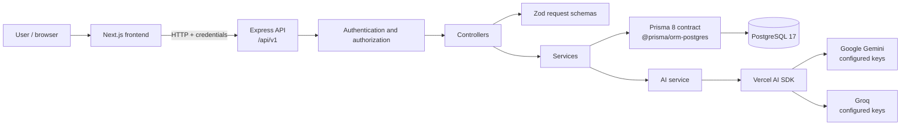

# DevMate AI

**A browser-based development workspace for organizing projects, editing code, and getting AI assistance grounded in your project files.**

[](https://dev-mate-ai-frontend.vercel.app/)
[](https://nextjs.org/)
[](https://react.dev/)
[](https://www.typescriptlang.org/)
[](https://bun.sh/)
[](https://www.postgresql.org/)

**Production frontend:** [dev-mate-ai-frontend.vercel.app](https://dev-mate-ai-frontend.vercel.app/)  
**Backend deployment:** [dev-mate-ai-backend.vercel.app](https://dev-mate-ai-backend.vercel.app/)

## Overview

DevMate AI brings project organization, a file-based code workspace, and an AI coding assistant together in one browser application. It is intended for developers who want to keep small project files organized, edit them without leaving the browser, and ask questions with relevant project code included as context.

Unlike a standalone editor paired with a context-free chatbot, the assistant can receive the project's file-path index and a limited set of relevant file contents. The active file's current editor content is used when applicable, so a question can include work that has not yet been saved. The application currently provides AI responses in chat; it does not execute code or automatically apply generated changes to a file.

## Features

- **Accounts:** Register, log in, log out, check the current session, and request or complete a password reset.
- **Cookie-based sessions:** Signed JWT authentication tokens are stored in an HTTP-only cookie.
- **Project management:** Create, list, view, rename/update, and delete projects. Project names are unique per account.
- **Project files and folders:** Create, list, read, update, rename, move, and delete files; create, list, rename, move, and delete folders.
- **Nested folders:** Folders can be created within other folders, relocated, and displayed in a hierarchical file tree.
- **Browser code editor:** Edit project files in Monaco with language selection based on common file extensions.
- **Explicit save and discard:** Save the selected file on request, see unsaved-change status, and discard edits when closing a changed file. A browser navigation warning is shown when edits are pending.
- **Project-aware AI chat:** Ask coding questions using project paths, matching files (up to five), or the active file as context. The active file's current editor contents are used when it is included.
- **Multiple AI provider configurations:** The backend can use configured Google Gemini and Groq providers and rotates/fails over between available configured keys.

**Not currently implemented:** There is no Online Compiler/code-execution integration, no dedicated AI operation endpoint for explanation/debugging/refactoring/review, and no one-click “Apply to Editor” action. The AI chat accepts a natural-language prompt and displays the provider's text response; users can manually copy suggestions into the editor.

## Screenshots and Demo

Screenshots are not included in the repository yet. Add genuine captures under `docs/screenshots/` and replace each placeholder link when available.

| Screen | Screenshot |
| --- | --- |
| Landing page | _Add `docs/screenshots/landing-page.png`_ |
| Authentication | _Add `docs/screenshots/authentication.png`_ |
| Project dashboard | _Add `docs/screenshots/dashboard.png`_ |
| Code workspace | _Add `docs/screenshots/workspace.png`_ |
| Monaco editor | _Add `docs/screenshots/monaco-editor.png`_ |
| AI assistant | _Add `docs/screenshots/ai-assistant.png`_ |
| Online compiler output | _Not available: code execution is not implemented._ |

## Architecture

The Next.js client calls the versioned Express API. The API authenticates requests, validates input, applies project ownership checks in services, and accesses PostgreSQL through the generated Prisma contract and `@prisma/orm-postgres`. AI prompts are sent by the backend to configured Google Gemini or Groq providers through the Vercel AI SDK.



**Responsibilities**

- `frontend/app/` contains the App Router pages and shared providers; `frontend/components/` contains the landing, authentication, dashboard, and project workspace UI.
- `frontend/lib/` contains Axios API clients. `frontend/hooks/` wraps server-state operations with TanStack React Query.
- `backend/src/routes/` maps HTTP paths to middleware and controllers. `backend/src/controller/` validates requests, calls services, and produces HTTP responses.
- `backend/src/schemas/` defines Zod request validation. `backend/src/middlewares/` handles authentication, origin checks, and error responses.
- `backend/src/services/` contains account, project/file/folder, AI-provider, email, and database-error logic.
- `backend/src/prisma/contract.prisma` is the database contract. `backend/src/prisma/contract.json` and `contract.d.ts` are generated contract artifacts consumed by `backend/src/prisma/db.ts`.
- `backend/migrations/` contains the Prisma 8 migration history.

## Project Structure

The following is a high-level view of directories and key files present in this repository:

```text
.
├── .github/
│   └── workflows/
│       └── bun-ci.yml
├── .postman/
├── backend/
│   ├── migrations/
│   │   ├── app/
│   │   └── snapshots/
│   ├── scripts/
│   ├── src/
│   │   ├── config/
│   │   ├── controller/
│   │   ├── middlewares/
│   │   ├── prisma/
│   │   ├── routes/
│   │   ├── schemas/
│   │   ├── services/
│   │   ├── types/
│   │   └── utils/
│   ├── tests/
│   │   └── unit/
│   ├── index.ts
│   ├── package.json
│   └── prisma.config.ts
├── frontend/
│   ├── app/
│   │   ├── (auth)/
│   │   ├── dashboard/
│   │   └── projects/
│   ├── components/
│   │   ├── auth/
│   │   ├── dashboard/
│   │   ├── landing/
│   │   ├── layout/
│   │   ├── projects/
│   │   └── ui/
│   ├── hooks/
│   ├── lib/
│   ├── public/
│   └── package.json
├── postman/
├── docker-compose.yml
└── README.md
```

## Tech Stack

| Area | Technology | Role |
| --- | --- | --- |
| Frontend | Next.js 16, React 19, TypeScript | App Router UI and typed client application |
| Styling and UI | Tailwind CSS 4, shadcn/ui components with Base UI | Styling and reusable interface components |
| Client data and HTTP | TanStack React Query, Axios | API requests, mutations, and server-state caching |
| Editor and notifications | Monaco Editor (`@monaco-editor/react`), Sonner | In-browser source editing and toast feedback |
| Backend | Express 5, TypeScript, Bun | Versioned JSON API and server runtime/tooling |
| Validation and auth | Zod 4, HMAC-SHA256 JWT, Node.js `scrypt` | Request validation, signed sessions, and password hashing |
| Database | PostgreSQL 17, Docker Compose | Relational persistence and local database service |
| Database access | Prisma 8 RC, `@prisma/orm-postgres` | Prisma contract, migrations, and typed PostgreSQL ORM access |
| AI | Vercel AI SDK, `@ai-sdk/google`, `@ai-sdk/groq` | Text generation through configured Gemini and Groq providers |

## Installation and Local Setup

### Prerequisites

- Git
- Bun 1.3.14 or compatible (the frontend manifest pins `bun@1.3.14`)
- Node.js 24.x for the backend's declared engine and test runner
- Docker Desktop with Docker Compose

### Clone and install

Run these commands in PowerShell:

```powershell
git clone https://github.com/AnandAyush005/DevMate-Ai.git
Set-Location .\DevMate-Ai

Set-Location .\backend
bun install --frozen-lockfile

Set-Location ..\frontend
bun install --frozen-lockfile
Set-Location ..
```

### Start PostgreSQL

From the repository root, start the PostgreSQL 17 service defined in `docker-compose.yml`:

```powershell
docker compose up -d
```

The local database connection string must use the user, password, database, and port configured by that Compose file. Keep credentials local; do not commit `.env` files.

### Configure environment

Create `backend\.env` and `frontend\.env.local` manually using the examples in [Environment Variables](#environment-variables). Replace every placeholder with a valid local value. `DATABASE_URL` must match the local PostgreSQL Compose configuration.

### Apply database migrations

With PostgreSQL running and `backend\.env` configured:

```powershell
Set-Location .\backend
bun run db:migrate
```

This invokes the Prisma 8 CLI command configured by the backend package script (`prisma db migrate`) and uses `prisma.config.ts` plus the contract at `src/prisma/contract.prisma`. Other available scripts include `db:status`, `db:plan`, and `db:emit`. No destructive reset command is required for setup.

### Run the backend and frontend

Start the backend in one PowerShell window:

```powershell
Set-Location .\backend
bun run dev
```

Start the frontend in a second PowerShell window:

```powershell
Set-Location .\frontend
bun run dev
```

Open [http://localhost:3000](http://localhost:3000). The API listens on port `5000` by default.

### Available checks

```powershell
Set-Location .\backend
bun run test
bun run typecheck
bun run build

Set-Location ..\frontend
bun run lint
bun run build
```

The GitHub Actions workflow currently installs backend dependencies and runs the backend unit tests for changes under `backend/`.

## Environment Variables

All values below are placeholders. Never commit actual secrets or production configuration.

### Frontend: `frontend\.env.local`

```dotenv
NEXT_PUBLIC_BACKEND_URL=http://localhost:5000/api/v1
```

| Variable | Required? | Purpose |
| --- | --- | --- |
| `NEXT_PUBLIC_BACKEND_URL` | Yes | Axios API base URL. Include the `/api/v1` prefix; frontend API clients append paths such as `/projects`. |

### Backend: `backend\.env`

```dotenv
DATABASE_URL=YOUR_POSTGRES_CONNECTION_STRING_HERE
JWT_SECRET=YOUR_SECRET_HERE
FRONTEND_URL=http://localhost:3000
PORT=5000
NODE_ENV=development

# Configure at least one AI provider key to enable AI responses.
GEMINI_API_KEY_1=YOUR_GEMINI_API_KEY_HERE
GEMINI_API_KEY_2=
GROQ_API_KEY_1=
GROQ_API_KEY_2=

# Optional: required for password-reset email delivery.
SMTP_HOST=
SMTP_PORT=587
SMTP_SECURE=false
SMTP_USER=
SMTP_PASS=
SMTP_FROM=
COOKIE_SAME_SITE=lax
```

| Variable | Required? | Purpose |
| --- | --- | --- |
| `DATABASE_URL` | Yes | PostgreSQL connection string used by Prisma configuration and the PostgreSQL ORM runtime. |
| `JWT_SECRET` | Yes | HMAC signing secret; startup validation requires at least 32 bytes. |
| `FRONTEND_URL` | Yes | Frontend origin used for CORS, origin validation, and password-reset links. |
| `PORT` | No | HTTP port; defaults to `5000`. |
| `NODE_ENV` | No | Set to `production` in production; controls secure-cookie behavior. |
| `GEMINI_API_KEY_1`, `GEMINI_API_KEY_2` | No | Optional Google Gemini API keys. |
| `GROQ_API_KEY_1`, `GROQ_API_KEY_2` | No | Optional Groq API keys. At least one of the four AI keys is needed for AI generation; without one, the AI endpoint returns a service-unavailable error. |
| `SMTP_HOST` | No | SMTP host for password-reset email. Password reset email delivery is unavailable when this is unset. |
| `SMTP_PORT` | No | SMTP port; defaults to `587` and must be a positive integer. |
| `SMTP_SECURE` | No | Enables SMTP TLS when set to `true`; defaults to `false`. |
| `SMTP_USER`, `SMTP_PASS` | No | Optional SMTP authentication credentials; authentication is configured when `SMTP_USER` is set. |
| `SMTP_FROM` | No | Optional sender identity; defaults to `SMTP_USER`, then a development-only fallback. |
| `COOKIE_SAME_SITE` | No | Cookie SameSite policy: `strict`, `lax`, or `none`; defaults to `lax`. Production cookies are secure. |
| `VERCEL` | Platform-provided | Vercel sets this in its runtime; the backend avoids opening a standalone listener when running in production on Vercel. It is not normally set manually. |

The installed `dotenv/config` loader reads local backend environment values. For production, configure variables in the hosting platform rather than committing a secret file.

## API Documentation

All routes are mounted under `/api/v1`. Protected routes require the `devmate_auth` cookie. Mutating routes generally also apply request-origin validation.

### Health

| Method | Endpoint | Purpose | Authentication |
| --- | --- | --- | --- |
| `GET` | `/api/v1/health` | Return API health status | No |

### Authentication

| Method | Endpoint | Purpose | Authentication |
| --- | --- | --- | --- |
| `POST` | `/api/v1/auth/register` | Register an account and set the auth cookie | No |
| `POST` | `/api/v1/auth/login` | Authenticate and set the auth cookie | No |
| `GET` | `/api/v1/auth/me` | Return the current user | Yes |
| `POST` | `/api/v1/auth/logout` | Clear the auth cookie | Yes |
| `POST` | `/api/v1/auth/forgot-password` | Request a password-reset email | No |
| `GET` | `/api/v1/auth/reset-password/:token` | Check a password-reset link | Reset token |
| `POST` | `/api/v1/auth/reset-password/:token` | Set a new password and establish a session | Reset token |

### Projects, folders, and files

| Method | Endpoint | Purpose | Authentication |
| --- | --- | --- | --- |
| `GET` | `/api/v1/projects` | List the signed-in user's projects | Yes |
| `POST` | `/api/v1/projects` | Create a project | Yes |
| `GET` | `/api/v1/projects/:projectId` | Retrieve a project | Yes |
| `PATCH` | `/api/v1/projects/:projectId` | Update project name or description | Yes |
| `DELETE` | `/api/v1/projects/:projectId` | Delete a project | Yes |
| `GET` | `/api/v1/projects/:projectId/files` | List file metadata and paths | Yes |
| `POST` | `/api/v1/projects/:projectId/files` | Create a file, optionally in a folder | Yes |
| `GET` | `/api/v1/projects/:projectId/files/:fileId` | Retrieve file content | Yes |
| `PATCH` | `/api/v1/projects/:projectId/files/:fileId` | Update file content, name, or folder | Yes |
| `DELETE` | `/api/v1/projects/:projectId/files/:fileId` | Delete a file | Yes |
| `GET` | `/api/v1/projects/:projectId/folders` | List project folders | Yes |
| `POST` | `/api/v1/projects/:projectId/folders` | Create a folder, optionally nested | Yes |
| `PATCH` | `/api/v1/projects/:projectId/folders/:folderId` | Rename or relocate a folder | Yes |
| `DELETE` | `/api/v1/projects/:projectId/folders/:folderId` | Delete a folder | Yes |

### AI

| Method | Endpoint | Purpose | Authentication |
| --- | --- | --- | --- |
| `POST` | `/api/v1/ai/generate` | Generate a text response from a prompt (maximum 20,000 characters) | Yes |

**Response format:** Successful controller responses use `{ "success": true, "data": ... }`. Errors use `{ "success": false, "error": { "code": "...", "message": "..." } }`. Status codes vary by route; validation failures use HTTP 400, unauthenticated requests use 401, and unexpected errors return a generic 500 response.

## Authentication and Security

- Authentication tokens are signed using HMAC-SHA256 and expire after seven days.
- The token is stored in the `devmate_auth` HTTP-only cookie, not browser JavaScript storage. Cookies use `Secure` in production and a configurable `SameSite` value (default `lax`).
- Passwords are hashed with Node.js `scrypt`, a per-password random salt, and constant-time comparison during verification.
- Password-reset tokens are stored as SHA-256 hashes and expire after one hour.
- Project, folder, and file operations verify the authenticated user's ownership of the project before accessing its data.
- Zod schemas validate request bodies and parameters. The JSON body parser is limited to 32 KB.
- CORS allows the configured `FRONTEND_URL` and `http://localhost:3000`, with credentials enabled. A request-origin middleware additionally rejects a supplied origin that differs from the configured frontend origin on routes that use it.

## AI Assistant Workflow

1. The workspace creates an AI prompt from the user's message and the project's file-path index. The index is capped at 3,000 characters.
2. The frontend matches paths/names mentioned in the request and includes up to five matching project files. If there are no matches, it uses the active file when one is open. The active file's current editor buffer is used; other included files are fetched from the API.
3. Context and user text are assembled into a prompt, with the total prompt constrained to 20,000 characters and oversized file contents truncated to fit.
4. The frontend sends the assembled prompt to the authenticated `POST /api/v1/ai/generate` endpoint. The backend validates it and calls the Vercel AI SDK `generateText` function.
5. Configured Gemini and Groq providers are tried in rotation. Failed providers are temporarily placed in a 60-second cooldown; the resulting text is returned to the chat UI.
6. The assistant response is displayed in the chat. The editor's explicit save/discard flow is unchanged: unsaved edits remain in workspace state and can be saved or discarded by the user.

This is request/response chat, not an autonomous coding agent. There is no tool execution, Online Compiler integration, dedicated structured code-operation API, or automatic editor mutation. Generated suggestions must be applied manually.

## Deployment

The published application and backend URLs are:

- **Frontend:** [https://dev-mate-ai-frontend.vercel.app/](https://dev-mate-ai-frontend.vercel.app/)
- **Backend:** [https://dev-mate-ai-backend.vercel.app/](https://dev-mate-ai-backend.vercel.app/)

For these deployments, configure the frontend's `NEXT_PUBLIC_BACKEND_URL` to the backend API base URL, including `/api/v1` (for example, `https://dev-mate-ai-backend.vercel.app/api/v1`). Configure the backend's `FRONTEND_URL` to the deployed frontend origin and set `DATABASE_URL`, `JWT_SECRET`, and any desired AI-provider or SMTP values in the hosting environment.

The backend exports an Express app for the Vercel entry point and skips `app.listen()` in the production Vercel runtime. Its CORS configuration allows the configured frontend origin and credentialed requests. Production cookies are HTTP-only and secure; the configured SameSite policy must be compatible with the deployment's browser origin relationship. The backend also needs network access to the PostgreSQL server named by `DATABASE_URL`. Use a managed or otherwise reachable PostgreSQL instance for hosted deployment; the repository's Docker Compose service is for local development.

Password-reset email delivery additionally requires valid SMTP configuration. AI responses require at least one configured Gemini or Groq key. Keep all backend secrets in the hosting provider's environment settings, not in frontend-prefixed variables or source control.
